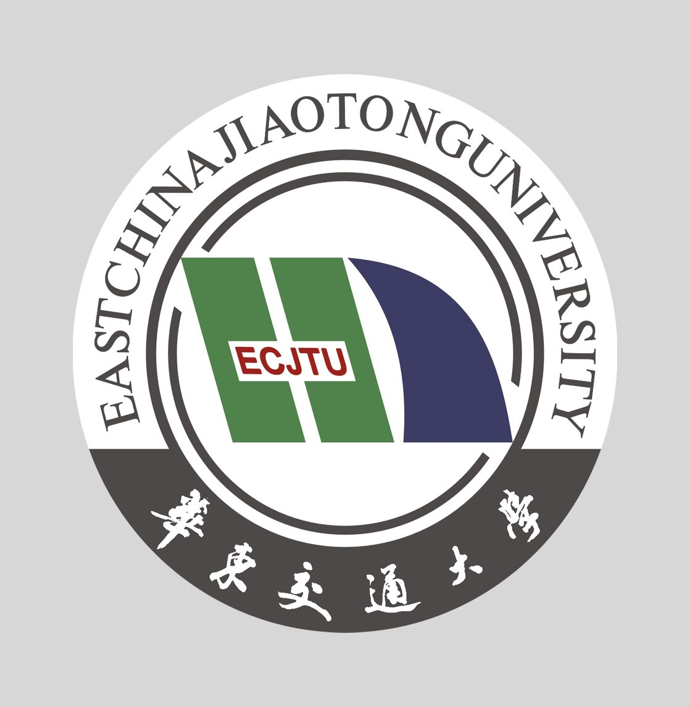
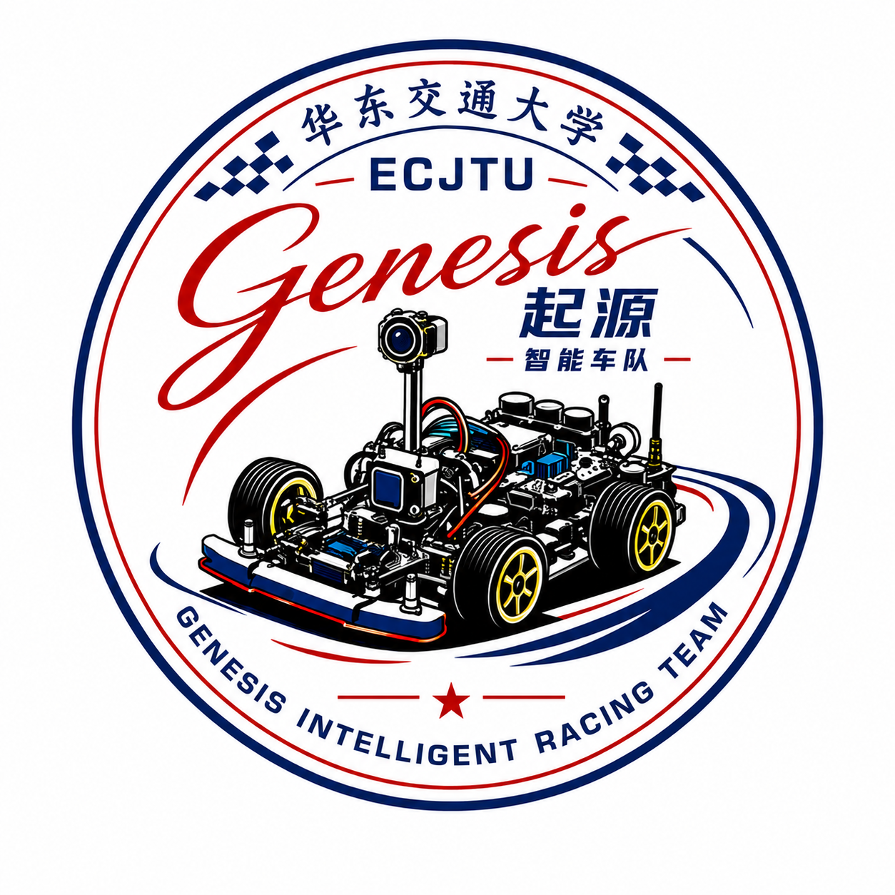
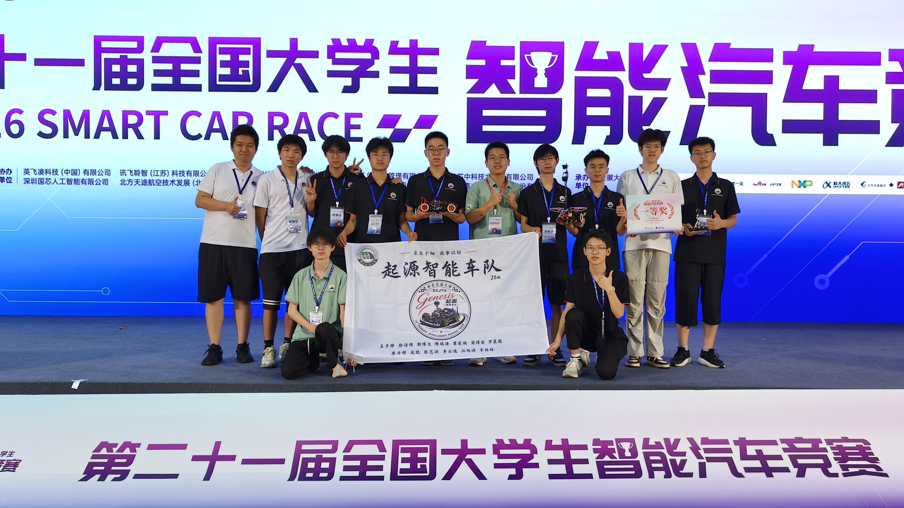

  
  &nbsp;&nbsp;&nbsp;&nbsp;
  

<h1 align="center">华东交通大学 · Genesis 起源智能车队</h1>

East China Jiaotong University · Genesis Intelligent Racing Team

<strong>求真于细，成事以恒</strong>

  <a href="https://genesis-racing-team---ecjtu.pages.dev/"><strong>访问车队官网 →</strong></a>

  

<em>第二十一届全国大学生智能汽车竞赛全国总决赛 · 车队合影</em>

## 关于我们

**Genesis 起源智能车队**是华东交通大学依托电气与自动化工程学院建设、由杨云老师指导、以本科生为主体的学生科技创新团队。我们面向全国大学生智能汽车竞赛、电子设计竞赛、机器人大赛等赛事，汇聚自动化、电气、电子信息、计算机与机械等专业的同学，共同完成从算法设计、电路开发到机械装配与整车调试的工程实践。

从实验室里的第一行代码、第一块电路板，到赛道上的每一次出发，车队坚持以赛促学、以赛促研、以赛促创。我们通过“一周一会”、技术交流和老队员带新队员的方式积累经验、传承方法，让每一届成员都能在真实项目中成长。

**实验室：** 华东交通大学南区基础实验大楼 31 栋 102 · 智行智能汽车实验室。

## 我们在做什么

| 方向 | 主要工作 |
| --- | --- |
| 视觉与算法 | 图像处理、赛道识别、目标检测、路径规划与智能感知 |
| 嵌入式与电控 | 主控程序、传感器采集、电机与舵机控制、轨迹跟踪及整车联调 |
| 硬件电路 | 电路与 PCB 设计、电源管理、焊接测试和故障排查 |
| 机械结构 | 底盘与支架设计、加工装配、轻量化及可靠性优化 |
| 综合管理 | 项目统筹、训练安排、赛事组织、宣传记录与技术复盘 |

## 竞赛足迹

2026 年，车队在**第二十一届全国大学生智能汽车竞赛**中取得历史最佳成绩：

| 参赛组别 | 全国总决赛 | 赛区 / 选拔赛 |
| --- | --- | --- |
| 走马观碑 | 全国一等奖 | 华东赛区一等奖 |
| 智慧城市 Robotaxi | 全国一等奖 | 选拔赛一等奖 |
| 疯狂电路 | 全国二等奖 | 华东赛区一等奖 |
| 人工智能模型 | 全国二等奖 | 华东赛区一等奖 |

车队也持续参与电子设计、人工智能等相关竞赛。历年参赛队伍、队员风采、获奖记录与车队动态请访问[车队官网](https://genesis-racing-team---ecjtu.pages.dev/)。

## 加入起源

欢迎对智能车、嵌入式开发、机器视觉、硬件电路或机械设计感兴趣的同学加入我们。车队主要面向大一、大二本科生招新，也欢迎其他专业有兴趣的同学参加选拔。

2026 年招新 QQ 群：**1109035280**。招新安排、报名方式与选拔规则以当年的车队通知为准。

## 关于本仓库

本仓库用于公开展示车队简介、校徽、队徽和合照。完整网站工程由车队通过私有仓库维护；公开官网可正常访问。
